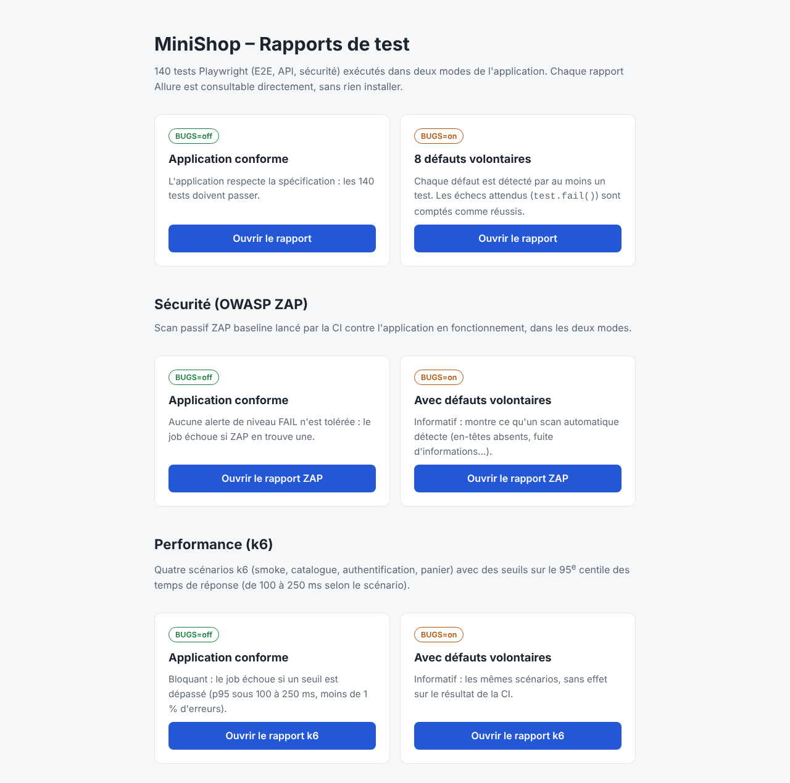
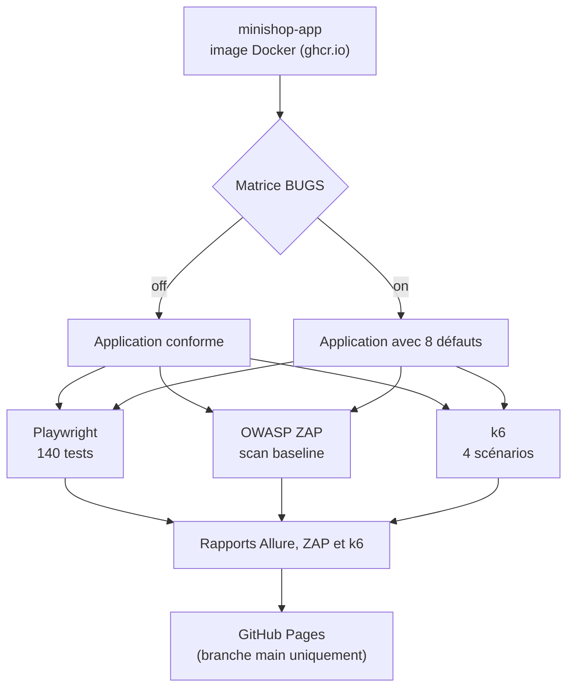
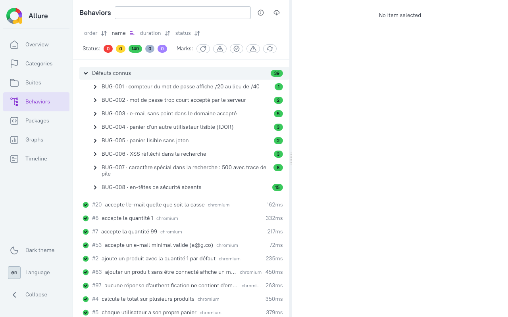

# minishop-tests

Framework de test automatisé (Playwright, TypeScript) pour [`minishop-app`](https://github.com/fatima-ezzahra-kasraoui/-Minishop-app) : E2E, API et sécurité de premier niveau, avec Page Object Model, un scan de sécurité OWASP ZAP, des tests de performance k6, une CI à deux modes et une documentation de test complète.

[](https://github.com/fatima-ezzahra-kasraoui/minishop-tests/actions/workflows/playwright.yml)

## Rapports en ligne

**<https://fatima-ezzahra-kasraoui.github.io/minishop-tests/>** : les rapports Allure, ZAP et k6 des deux modes, publiés à chaque push sur `main`. Aucune installation n'est nécessaire pour les consulter.



## Principe

L'application existe en deux modes, choisis par la variable `BUGS` :

| Mode | Application | Résultat attendu de la suite |
|---|---|---|
| `BUGS=off` | conforme à la spécification | tous les tests passent |
| `BUGS=on` | 8 défauts volontaires | chaque défaut est détecté par au moins un test |

Un test qui vise un défaut connu appelle `expectBug('BUG-00X')` (`utils/bugs.ts`), basé sur `test.fail()` de Playwright : tant que le défaut est actif, l'échec est attendu et rapporté comme réussi ; si le test se met à passer, Playwright le signale, ce qui indique que le bug est corrigé. `expectBug()` étiquette aussi le test pour Allure (epic « Défauts connus », une feature par défaut, sévérité), ce qui regroupe les 39 tests de défauts dans l'onglet Behaviors du rapport.

Avant toute exécution, `utils/global-setup.ts` attend l'application et **refuse de tourner si son mode ne correspond pas à `BUGS`** : lancer la suite en `off` contre une application en `on` produirait des échecs trompeurs.

## Pipeline

À chaque push, pull request ou déclenchement manuel, la CI récupère l'image de l'application, la démarre dans chacun des deux modes, puis lance trois contrôles en parallèle :



| Contrôle | Outil | `BUGS=off` | `BUGS=on` |
|---|---|---|---|
| Fonctionnel, API, sécurité | Playwright | les 140 tests passent | les 140 tests passent (39 échecs attendus) |
| Sécurité, scan passif | OWASP ZAP baseline | le job échoue sur une alerte de niveau FAIL | informatif |
| Performance | k6 | le job échoue si un seuil est dépassé | informatif |

Le workflow est `.github/workflows/playwright.yml`. Il se déclenche aussi par `repository_dispatch` (type `app-image-published`) ou à la main (`workflow_dispatch`).

## Prérequis

- Node.js 22 ou plus
- L'application démarrée sur `http://localhost:3000` (variable `BASE_URL` pour changer l'adresse)
- Pour k6 en local : [k6](https://grafana.com/docs/k6/latest/set-up/install-k6/) ; pour le rapport Allure en local : Java

## Lancer

```bash
# 1. Application (dépôt minishop-app), mode correct
docker run -d --name minishop -p 3000:3000 -e BUGS=off ghcr.io/fatima-ezzahra-kasraoui/minishop-app
# ou, sans Docker : cd ../minishop-app && npm ci && npm start

# 2. Tests
npm ci
npx playwright install chromium
npm test                       # toute la suite
npm run test:e2e               # ou test:api, test:security
npm run report                 # rapport HTML Playwright

# 3. Rapport Allure (après npm test)
npm run allure:generate
npm run allure:open

# 4. Performance
mkdir -p k6-out && k6 run k6/minishop.js
```

Pour le mode avec défauts, relancer l'application avec `-e BUGS=on` et lancer les tests avec la **même** valeur :

```bash
BUGS=on npm test
```

Sous Windows PowerShell : `$env:BUGS="on"; npm.cmd test`. Si les scripts sont bloqués par la stratégie d'exécution, utiliser `npm.cmd` et `npx.cmd`.

## Structure

```
minishop-tests/
├── tests/
│   ├── e2e/          interface (inscription, connexion, produits, panier)
│   ├── api/          contrat et validation côté serveur
│   ├── security/     accès, jetons, XSS, en-têtes HTTP
│   └── fixtures.ts   Page Objects et client d'API injectés dans chaque test
├── pages/            Page Objects (Register, Login, Products, Basket)
├── utils/            données uniques, client d'API, messages de la spec, garde de mode
├── k6/               tests de performance (minishop.js : 4 scénarios, lib.js : aides)
├── scripts/          capture-evidence.mjs (preuves des bugs), pages-index.html (accueil du site),
│                     zap-summary.mjs (résumé du scan ZAP)
├── docs/
│   ├── test-plan.md       stratégie, analyse de risque, résultats
│   ├── TC-inscription.md  20 cas de test manuels
│   ├── bugs/              BUG-001.md à BUG-008.md
│   ├── evidence/          captures et réponses HTTP brutes
│   └── img/               captures des rapports de ce README
└── .github/workflows/playwright.yml
```

Choix de conception :

- les sélecteurs vivent dans les Page Objects (via `data-testid`), jamais dans les tests ;
- chaque test crée ses propres comptes (`uniqueEmail()`) : pas de dépendance entre tests, exécution parallèle ;
- les messages attendus sont centralisés dans `utils/messages.ts` d'après la spécification ;
- pas de relance automatique (`retries: 0`) : un test instable doit se voir.

## Résultats

### Tests Playwright

140 tests dans les deux modes, **0 échec inattendu**. Répartition mesurée lors d'une exécution locale du 25 octobre 2026 (Chromium, Playwright 1.63.0, une passe sans relance) ; la CI du 31 octobre 2026 confirme 140 tests réussis dans chaque mode.

| Type de test | Tests | `BUGS=off` : passés | `BUGS=on` : passés | `BUGS=on` : échecs attendus |
|---|---|---|---|---|
| E2E | 36 | 36 | 32 | 4 |
| API | 70 | 70 | 58 | 12 |
| Sécurité | 34 | 34 | 11 | 23 |
| **Total** | **140** | **140** | **101** | **39** |

### Les 8 défauts

| Bug | Famille | Sévérité | Tests en échec attendu | Détecté par ZAP |
|---|---|---|---|---|
| [BUG-001](docs/bugs/BUG-001.md) | Interface | Faible | 1 | non |
| [BUG-002](docs/bugs/BUG-002.md) | Validation serveur | Moyenne | 2 | non |
| [BUG-003](docs/bugs/BUG-003.md) | Validation | Moyenne | 5 | non |
| [BUG-004](docs/bugs/BUG-004.md) | Contrôle d'accès (IDOR) | Haute | 3 | non |
| [BUG-005](docs/bugs/BUG-005.md) | Authentification | Haute | 2 | non |
| [BUG-006](docs/bugs/BUG-006.md) | Injection (XSS) | Haute | 3 | non |
| [BUG-007](docs/bugs/BUG-007.md) | Robustesse | Moyenne | 8 | non |
| [BUG-008](docs/bugs/BUG-008.md) | Configuration | Moyenne | 15 | **oui** |

Les 8 défauts sont détectés par les tests Playwright. Un scan passif ne trouve que le BUG-008 : les autres demandent de se connecter, de saisir des données ou de comparer avec la spécification. Les deux approches se complètent.

Dans le rapport Allure du mode `BUGS=on`, l'onglet Behaviors regroupe les tests par défaut :



*Capture d'un rapport généré en local avec cette suite en `BUGS=on` ; le rapport publié sur le site a le même contenu.*

### Sécurité : OWASP ZAP baseline

| Alertes | `BUGS=off` | `BUGS=on` |
|---|---|---|
| Haute | 0 | 0 |
| Moyenne | 0 | 2 |
| Faible | 0 | 6 |
| Information | 5 | 5 |

En mode `BUGS=on`, ZAP signale les conséquences du BUG-008 : CSP absente, en-tête anti-clickjacking manquant, `X-Content-Type-Options` manquant, `X-Powered-By` exposé, `Permissions-Policy` et `Cross-Origin-*` absents.

Le premier scan de l'application conforme (`BUGS=off`) avait remonté 1 alerte moyenne et 4 faibles. Elles ont été corrigées dans `minishop-app` :

- en-têtes `Permissions-Policy`, `Cross-Origin-Opener-Policy`, `Cross-Origin-Embedder-Policy` et `Cross-Origin-Resource-Policy`, et directive CSP `form-action` ([PR #1](https://github.com/fatima-ezzahra-kasraoui/-Minishop-app/pull/1)) ;
- la page 404 par défaut d'Express écrasait la CSP sur `/favicon.ico`, `/robots.txt` et `/sitemap.xml` ([PR #2](https://github.com/fatima-ezzahra-kasraoui/-Minishop-app/pull/2)).

Les 5 alertes d'information restantes sont acceptées : commentaires `BUG-00X (volontaire)` visibles dans `app.js` (application d'entraînement qui s'annonce comme telle), catalogue public sans durée de cache déclarée, et constats techniques sur le type d'application.

### Performance : k6

Mesures de la CI du 31 octobre 2026 en `BUGS=off` (2 567 requêtes, 0 erreur) :

| Scénario | Charge | p95 mesuré | Seuil |
|---|---|---|---|
| `smoke` | 1 utilisateur, 1 parcours complet | 50,6 ms | < 250 ms, aucune erreur |
| `catalog_load` | jusqu'à 15 utilisateurs (liste et recherche) | 1,1 ms | < 100 ms, moins de 1 % d'erreurs |
| `auth_load` | 1,5 inscription + 1,5 connexion par seconde | 46,2 ms | < 250 ms, moins de 1 % d'erreurs |
| `basket_flow` | 3 utilisateurs (ajout, lecture, retrait) | 4,3 ms | < 100 ms, moins de 1 % d'erreurs |

L'authentification est la route la plus coûteuse : le serveur hache les mots de passe avec scrypt de façon synchrone (≈ 60 ms de CPU par appel). Les charges de `auth_load` et `basket_flow` sont calibrées en conséquence.

## Limites assumées

- Les tests de sécurité couvrent le premier niveau (validation, contrôle d'accès, authentification, XSS). Le scan ZAP baseline de la CI est passif (il n'attaque pas l'application) et ne remplace ni un test d'intrusion ni un audit.
- Chromium uniquement ; pas de tests d'accessibilité.
- Les tests de performance sont une charge légère sur un runner partagé de la CI : ils détectent une régression nette, pas une capacité maximale. Les seuils sont fixés à 2 à 5 fois les valeurs mesurées sur la CI (davantage pour le catalogue et le panier) : assez serrés pour détecter une vraie régression, assez larges pour ne pas échouer au hasard sur un runner partagé.
- La stabilité sur de nombreuses exécutions n'est pas mesurée ; la CI a été exécutée quelques fois sans échec inattendu.
- Les cas manuels de `docs/TC-inscription.md` sont des fiches ; leur exécution manuelle n'est pas consignée.
